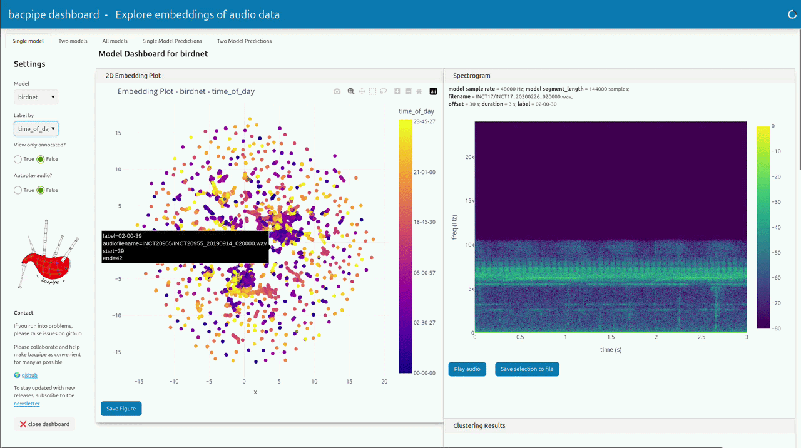

Welcome to the documentation for **bacpipe**
=================================

**bacpipe** makes using deep learning models for bioacoustics easy!
Using **bacpipe** you can generate embeddings and classifier predictions and evaluate them using probing, clustering and benchmarking. All you need is your audio data!.

And the best part is, it comes with an interactive GUI for you to explore your data organized by the state-of-the-art deep learning models for bioacoustics. 

   The bacpipe GUI for exploring embeddings. Find a live demo at https://bacpipe.siriusly.me including explanations of the different sections.

Full documentation can be found at https://bacpipe.readthedocs.io. 
**bacpipe** is also available on pip: `pip install bacpipe`

`import bacpipe`

`bacpipe.play()`

The github repository can be found at https://github.com/bioacoustic-ai/bacpipe.

.. toctree::
   :maxdepth: 2
   :caption: Contents:

   usage
   config
   settings
   models
   api_reference
   submodules

.. toctree::
   :maxdepth: 2
   :caption: Example Gallery:

   Simple Use Cases <examples/basic_examples/simple_use_cases>
   Using Different Bacpipe Functions <examples/basic_examples/using_different_bacpipe_functions>
   Clustering <examples/advanced_examples/clustering>
   Extending an Existing Model <examples/advanced_examples/extending_an_existing_model>
   Probing a Model <examples/advanced_examples/probing_a_model>
   Using a Custom Model <examples/advanced_examples/using_a_custom_model>

Indices and tables
==================

* :ref:`genindex`
* :ref:`modindex`
* :ref:`search`